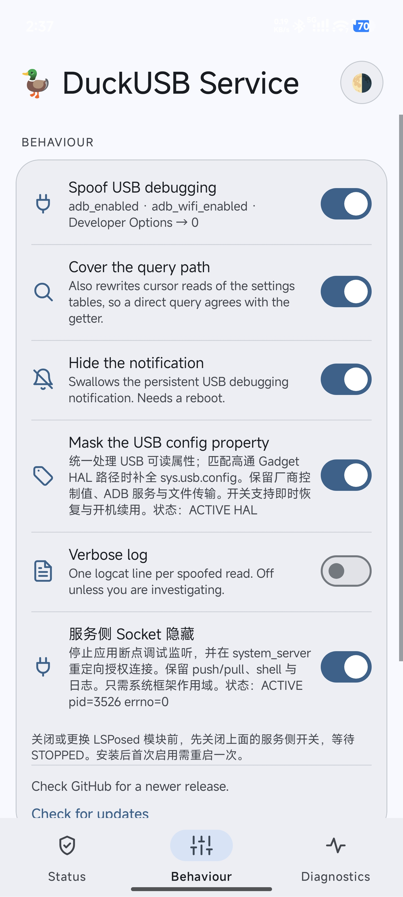
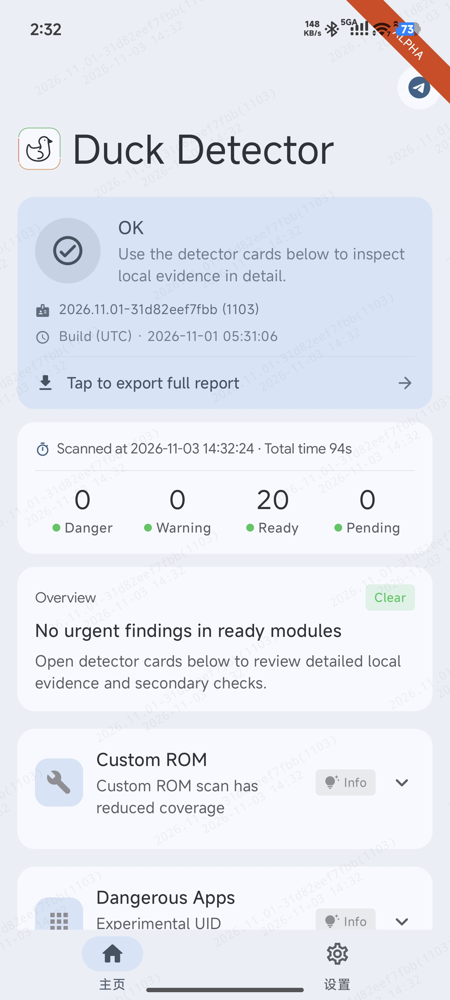
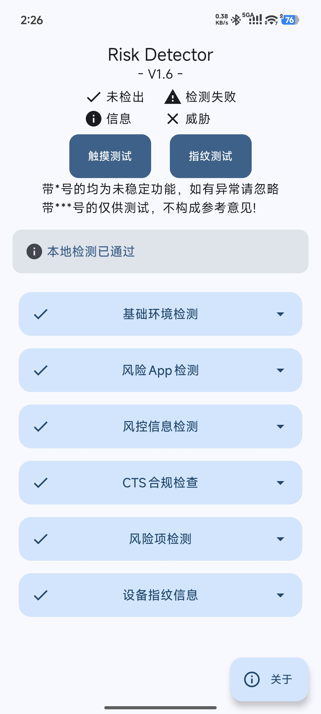

# DuckUSB Service · 服务增强版

在 DuckUSB 原有功能基础上，加入服务侧 Socket 管理和 USB 属性配套处理。在保持日常 USB 调试功能的同时，进一步完善 ADB 隐藏效果。

基于版本：**2.1.7**，ARM64 APK。增强维护：[Moderate-Qi](https://github.com/Moderate-Qi)。

## 相比原版增加

- **服务侧 Socket 隐藏开关。** 配套处理 ADB 授权通道与应用断点调试监听，改善 ADB 运行状态和相关 Socket 的隐藏效果。
- **补全 USB 属性管理。** 在匹配的高通 Gadget HAL 路径中加入 `sys.usb.config` 处理，并保留厂商 USB 控制值与文件传输功能。
- **保留常用 ADB 命令。** 日常继续使用 `adb push`、`adb pull`、shell、应用安装和 logcat。
- **兼顾 MT 管理器。** Root 终端、日志导出和本机排查功能继续使用。
- **系统框架统一作用。** 在 LSPosed 中选择系统框架作用域，即可向应用提供配套的服务侧结果。
- **状态直接可见。** 界面展示属性和 Socket helper 状态，支持保存开关、开机恢复和 ADB 服务重启后的重新处理。
- **独立管理与恢复。** 属性与 Socket 各有开关，方便按需调整。

## 使用方式

1. 从本仓库 Releases 下载 `DuckUSB-Service-2.1.7-service.2-arm64.apk`，安装配套 APK。
2. 在 LSPosed 中启用模块，选择“系统框架”，然后重启手机。
3. 进入 Behaviour 页面，按需启用调试状态、查询路径、通知、USB 属性和服务侧 Socket 开关。
4. 查看状态区域：属性显示 `ACTIVE HAL`，Socket helper 显示 `ACTIVE`。
5. 更换模块或调整 Socket 功能时，先关闭服务侧开关，等待状态显示 `STOPPED`，再进行后续操作。

## 实测环境

小米 14 Ultra，HyperOS 3.0.5.0，Android 16，SukiSU Ultra v4.3.0 / 41131-6（LKM），Zygisk Next 1.5.2（864），LSPosed 2.2.1（7912）。系统原始安全补丁日期为 2025-11-01。

## 界面与实测截图

### DuckUSB Service：属性与 Socket 功能状态

### Duck Detector 1103：20 Ready

### Risk Detector 1.6：本地检测已通过

### Native Test ++ Mean Minotaur（牛头）32：正常

## 来源、版权与许可证

上游项目：[DuckUSB / bf31eb6；Bouteillepleine 及原项目贡献者](https://github.com/Bouteillepleine/DuckUSB)。功能增强、集成和文档由 Moderate-Qi 维护，保留原作者署名与第三方版权记录。

独立新增文件采用 [GPL-3.0-only](LICENSE-LOCAL.md)，原项目代码版权归原作者。修改记录、文件授权范围和构建方式见 [CHANGELOG_LOCAL.md](CHANGELOG_LOCAL.md)、[NOTICE.md](NOTICE.md) 和 [BUILDING.md](BUILDING.md)。

## 配套项目

- [PIF 日期管理增强版](https://github.com/Moderate-Qi/PlayIntegrityFix)
- [TS-OSS 199 兼容增强版](https://github.com/Moderate-Qi/TrickyStoreOSS)
- [HMA-OSS UID 一体化增强版](https://github.com/Moderate-Qi/HMA-OSS-UID)
- [TrickyAddon 目标管理增强版](https://github.com/Moderate-Qi/TrickyAddon)

## 免责声明

如有侵权请联系我删除。

仅代表本人使用的当前系统和当前环境下的实测结果，且通过相关检测器不代表所有软件都检测不到环境异常，请勿用于游戏作弊等场景。
